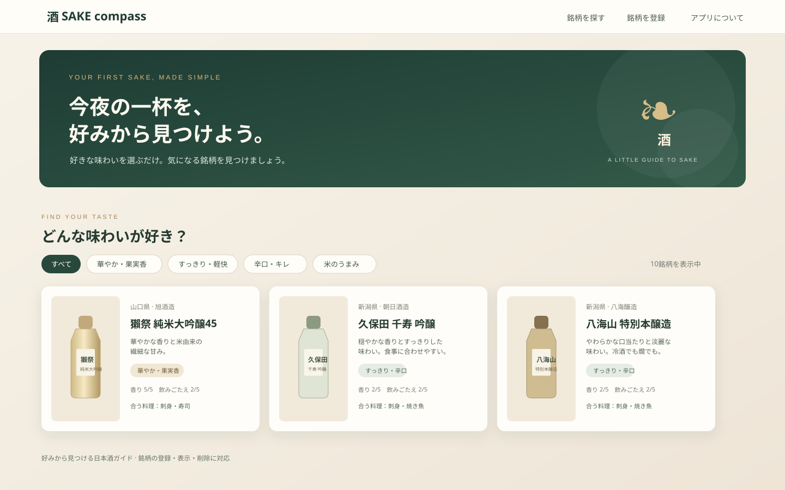

# SAKE compass

### 好みから、気軽に一杯。

日本酒の味がよく分からない人が、味わいの特徴から次の一杯を見つけられるアプリです。

**アプリを開く:** [https://sake-compass.onrender.com](https://sake-compass.onrender.com) · **銘柄データ/API:** [銘柄一覧を見る](https://sake-compass.onrender.com/api/sakes)

## アプリケーションの概要

味の説明だけでは選びにくい日本酒を、「華やか・果実香」「すっきり・辛口」などの味わいカテゴリから探せます。銘柄ごとに蔵元、産地、酒の種類、香り・飲みごたえの目安、相性のよい料理を確認できます。自分で銘柄を登録・表示・削除することもできます。

初期データとして有名銘柄10種を登録しています。画像は各銘柄の画像URLから読み込みます。

## 開発した背景・理由

開発者自身が日本酒好きでありながら、居酒屋で銘柄名を見ても味の違いが分からず、注文に迷うことがありました。同じような人が自分の好みに近い一本を選びやすくなるよう、味わいを手がかりに銘柄を探せるアプリを作りました。

## 主な使い方

1. [アプリを開く](https://sake-compass.onrender.com)。
2. 味わいカテゴリを選び、銘柄カードを見比べる。
3. 「銘柄を登録」フォームに情報を入力すると、一覧に追加される。
4. 不要な銘柄はカードの削除ボタンで取り除く。

味の説明や香り・飲みごたえの数値は選ぶ際の目安です。感じ方は銘柄や提供温度などで変わります。

## 使用技術

| 分類 | 技術 |
|---|---|
| フロントエンド | HTML、CSS、JavaScript（Vanilla JS） |
| バックエンド/API | Java 11、Spring Boot 2.7.18、Spring Web REST API |
| データアクセス | Spring Data JPA、Hibernate |
| データベース | PostgreSQL（公開環境）、H2 Database（ローカル環境） |
| 入力検証 | Jakarta Bean Validation（Spring Boot 2.7） |
| ビルド・実行 | Apache Maven、Docker |
| ホスティング | Render Web Service、Render PostgreSQL |

フロントエンドはJavaScriptの`fetch`でSpring Boot APIを呼び出します。APIはSpring Data JPAを通じてデータベースを読み書きします。

## ER図（データベース設計）

現状の登録・表示・削除対象は`SAKE`テーブルです。テーブル間の外部キー関係はありません。

~~~mermaid
erDiagram
    SAKE {
        BIGINT id PK "銘柄ID"
        VARCHAR name "銘柄名"
        VARCHAR brewery "蔵元"
        VARCHAR prefecture "都道府県"
        VARCHAR sake_type "酒の種類"
        VARCHAR flavor "味わいの説明"
        VARCHAR taste_group "味わいカテゴリ"
        INT aroma_level "香りの強さ 1-5"
        INT body_level "飲みごたえ 1-5"
        VARCHAR pairings "おすすめ料理"
        VARCHAR image_url "ボトル画像URL"
        VARCHAR product_url "商品情報URL"
    }
~~~

## インフラ構成図

ブラウザーに表示するHTML/CSS/JavaScriptもSpring Bootから配信します。GitHubの`main`ブランチへの変更はRenderのDockerデプロイに連携しています。

~~~mermaid
flowchart LR
    U[利用者のブラウザー HTML / CSS / JavaScript]
    GH[GitHub 公開リポジトリ]
    R[Render Web Service Docker / Spring Boot]
    DB[(Render PostgreSQL)]
    U -->|画面の取得・fetch API| R
    R -->|Spring Data JPA| DB
    GH -->|main更新で自動デプロイ| R
~~~

## ローカル環境での起動方法

### 必要なもの

- JDK 11以上
- 初回起動時に必要なMaven本体・依存ライブラリのダウンロード用インターネット接続

### Windows（PowerShell）

リポジトリを取得してプロジェクトのフォルダーへ移動し、次を実行します。

~~~powershell
git clone https://github.com/s21453075-sys/sake-compass.git
cd sake-compass
.\mvnw.cmd spring-boot:run
~~~

初回はMaven本体とJavaライブラリを自動で取得します。起動後、次のURLを開きます。

- アプリ: [http://localhost:8080/](http://localhost:8080/)
- 銘柄一覧API: [http://localhost:8080/api/sakes](http://localhost:8080/api/sakes)
- H2 Console: [http://localhost:8080/h2-console](http://localhost:8080/h2-console)（JDBC URL: `jdbc:h2:file:./data/sake_compass`、ユーザー: `sa`、パスワードなし）

初回起動時にサンプル10銘柄がデータベースへ登録されます。2回目以降は既存データがある場合に重複登録しません。

## API

| Method | Path | 内容 |
|---|---|---|
| `GET` | `/api/sakes` | 銘柄一覧 |
| `GET` | `/api/sakes/{id}` | 銘柄1件 |
| `POST` | `/api/sakes` | 銘柄登録 |
| `DELETE` | `/api/sakes/{id}` | 銘柄削除 |

## 公開環境について

Renderの無料Web Serviceと無料PostgreSQLで公開しています。無料Web Serviceは15分間アクセスがないと休止し、次のアクセス時に起動するため、最初の表示に時間がかかることがあります。無料PostgreSQLは作成から30日で期限切れになります。無料枠の詳細は[Renderの案内](https://render.com/docs/free)を確認してください。

## リポジトリ

[GitHub: s21453075-sys/sake-compass](https://github.com/s21453075-sys/sake-compass)

お酒は20歳になってから。飲酒運転は法律で禁じられています。

